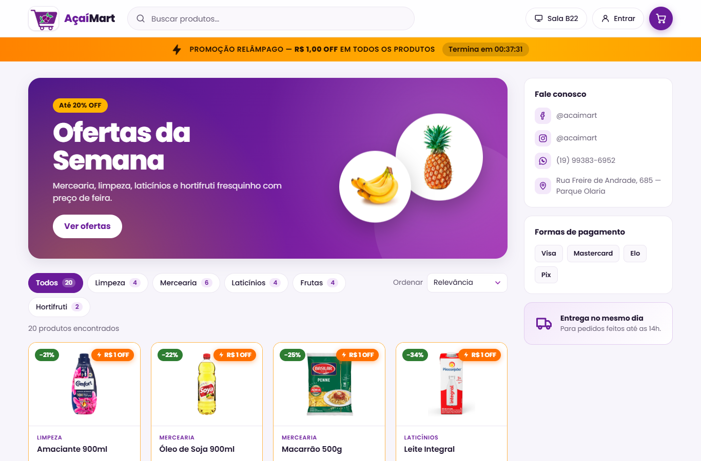
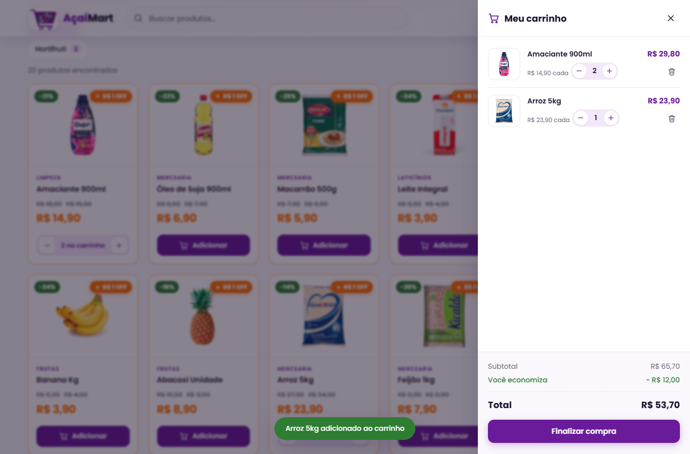
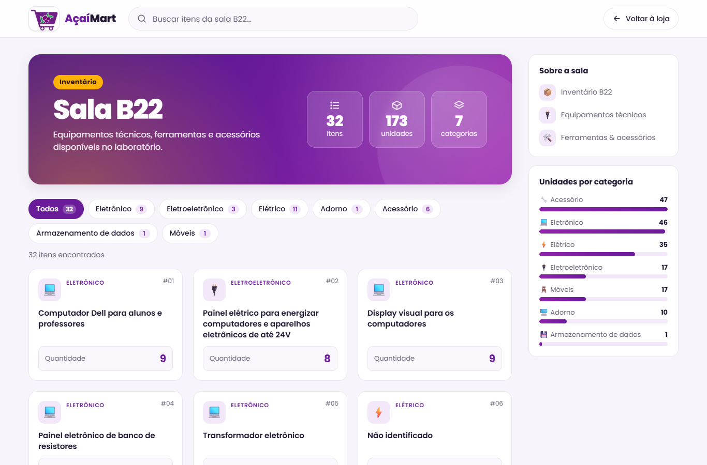
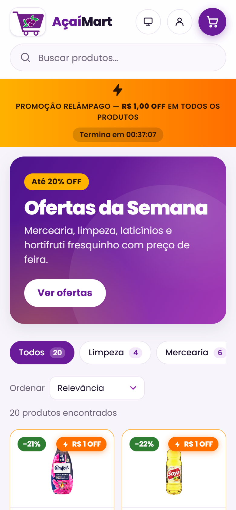
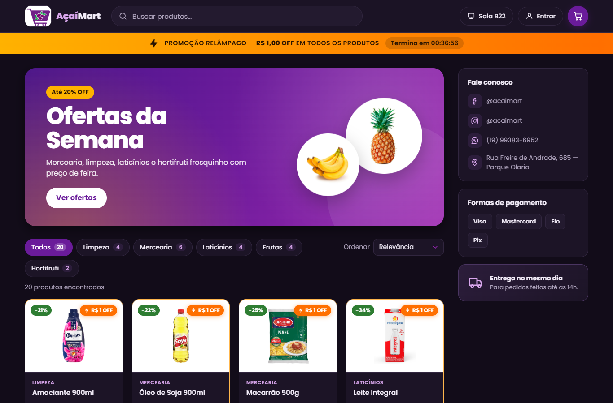

# Açaí Mart — SupermercadoFront

Exercício de front-end (SENAI) que simula a loja virtual de um supermercado, com catálogo de produtos, carrinho de compras, login de usuário e uma promoção-relâmpago dinâmica. Construído em **HTML, CSS e JavaScript puro (vanilla)**, sem frameworks.



## Telas

| Carrinho | Sala B22 |
|----------|----------|
|  |  |

| Celular | Tema escuro |
|---------|-------------|
|  |  |

## Funcionalidades

- **Catálogo de produtos** carregado dinamicamente a partir de um arquivo JSON (`db.json`), com preço atual, preço antigo, selo de % de desconto, imagem e categoria.
- **Filtro por categoria** (com contagem de itens), **busca em tempo real** (ignora acentos: "acucar" encontra "Açúcar") e **ordenação** (menor/maior preço, maior desconto, nome). Filtro, busca e ordenação funcionam em conjunto.
- **Carrinho de compras** em painel lateral, com:
  - adicionar / remover itens, direto do card ou pelo carrinho;
  - seletor de quantidade no próprio card do produto;
  - subtotal, valor economizado e total;
  - carrinho **salvo no navegador** (`localStorage`) — continua lá ao recarregar a página;
  - finalização de compra (exige login) com tela de confirmação.
- **Login de usuário** via modal (Enter envia, Esc ou clique fora fecha), validado contra a lista de usuários do JSON. A sessão dura enquanto a aba estiver aberta (`sessionStorage`).
- **Promoção-relâmpago automática**: das 15h às 17h, todos os produtos recebem R$ 1,00 de desconto, com faixa no topo e cronômetro regressivo. Ela liga e desliga sozinha, atualizando vitrine e carrinho.
- **Página "Sala B22"** (`b22.html`): inventário de equipamentos da sala, com resumo (itens, unidades, categorias), gráfico de unidades por categoria, filtros e busca.
- **Tema claro/escuro automático** (segue a preferência do sistema), layout responsivo e respeito a `prefers-reduced-motion`.
- **Notificações "toast"** para feedback das ações.

## Tecnologias

- **HTML5** semântico, com atributos de acessibilidade (ARIA, foco visível)
- **CSS3** — variáveis (design tokens), Grid, Flexbox, media queries
- **JavaScript (ES6+)** — Classes, `fetch`, `async/await`, delegação de eventos, Web Storage
- **JSON** como fonte de dados (sem backend)
- Fonte [Poppins](https://fonts.google.com/specimen/Poppins) via Google Fonts (com fallback para fontes do sistema)

Não há build step nem instalação de pacotes: é um projeto 100% estático.

## Estrutura do projeto

```
SupermercadoFront/
├── html/
│   ├── index.html        # Loja principal
│   ├── b22.html          # Inventário da Sala B22
│   ├── imagens/          # Imagens dos produtos e logo
│   └── JSON/
│       └── db.json       # Dados: produtos, usuários e itens da Sala B22
├── css/
│   └── style.css         # Estilos de toda a aplicação
├── js/
│   ├── utils.js          # Funções compartilhadas (moeda, busca, toast, storage)
│   ├── script.js         # Loja: catálogo, carrinho, login, promoção
│   └── b22.js            # Página da Sala B22
└── docs/
    └── screenshots/      # Capturas de tela usadas neste README
```

## Como executar

Como o app carrega dados via `fetch("JSON/db.json")`, os navegadores bloqueiam essa leitura quando o arquivo é aberto direto do disco (`file://`). Use um servidor local:

**Opção 1 — VS Code Live Server**
1. Abra a pasta do projeto no VS Code.
2. Clique com o botão direito em `html/index.html`.
3. Selecione **"Open with Live Server"**.

**Opção 2 — Python** (a partir da raiz do projeto, para que `../css` e `../js` funcionem)
```bash
python -m http.server 5500
```
Acesse `http://localhost:5500/html/index.html`.

**Opção 3 — Node.js**
```bash
npx serve .
```
Acesse `/html/index.html` no endereço exibido.

### Testando a promoção fora do horário

Abra a loja com `?promo=on` no final da URL (ex.: `http://localhost:5500/html/index.html?promo=on`) para forçar a promoção-relâmpago por 2 horas a partir do carregamento.

## Usuários de teste

| Nome     | E-mail          | Senha |
|----------|-----------------|-------|
| pedro    | pedro@gmail     | 1234  |
| alves    | alves@gmail     | 5678  |
| vinicius | vinicius@gmail  | 6967  |

## Observações

- Não há back-end: o `db.json` funciona como uma "API estática" local, e o login é apenas uma simulação (as senhas ficam visíveis no JSON).
- A promoção-relâmpago depende do horário do sistema do navegador (15h–17h).

## Histórico de alterações

### Repaginada (novembro de 2026)

**Correções**
- Filtro de categoria e busca não se sobrescrevem mais: os dois (e a ordenação) agora se combinam.
- Promoção-relâmpago reescrita com um único relógio: não duplica cronômetros, não atrasa com a aba em segundo plano, mantém o filtro ativo ao ligar/desligar e atualiza os preços do carrinho.
- Login: corrigido o campo de senha usado na autenticação, Enter envia o formulário, Esc/clique fora fecha o modal.
- Erro ao carregar o JSON agora mostra uma mensagem em vez de "Carregando..." para sempre.
- Busca ignora acentos e exibe aviso quando nada é encontrado.
- Ícone da faixa da promoção restaurado.

**Melhorias**
- Novo visual: tokens de cor, fonte Poppins, ícones SVG, tema escuro automático e layout responsivo.
- Ordenação de produtos, contagem por categoria e selo de % de desconto nos cards.
- Seletor de quantidade direto no card do produto.
- Carrinho com resumo de economia e salvo no navegador; tela de confirmação no lugar do `alert()`.
- Sala B22 com resumo do inventário e gráfico de unidades por categoria; script movido para `js/b22.js`.
- Código compartilhado extraído para `js/utils.js`; eventos sem `onclick` inline.
- Acessibilidade: botões reais em vez de links sem `href`, rótulos ARIA, foco visível e suporte a `prefers-reduced-motion`.

## Autor

Projeto desenvolvido por [vinicius-31008](https://github.com/vinicius-31008) como exercício da disciplina de Front-End do SENAI.

## Licença

Projeto acadêmico, sem licença específica definida.
